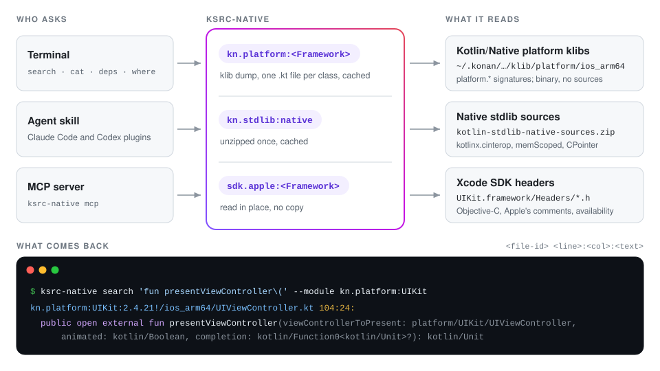

# ksrc-native

**One-liner search and read for Kotlin/Native platform APIs: `platform.*` signatures, `kotlinx.cinterop` sources and Xcode SDK headers.**

An agent that writes `iosMain` code guesses the Kotlin name of an Apple API from memory. It learns the guess was wrong after a slow Kotlin/Native compile. `ksrc-native` hands it the real signature in one command.

<p align="center">
  <picture>
    <source media="(prefers-color-scheme: dark)" srcset="docs/assets/how-it-works-dark.svg">
    
  </picture>
</p>

## What it is

A CLI for the sources that sit behind Kotlin/Native code on Apple platforms.

`iosMain` calls Apple frameworks through `platform.UIKit`, `platform.Foundation` and the other `platform.*` packages. `cinterop` generates those names from Objective-C headers, so they match neither Apple's documentation nor Swift:

| Where you look | What you see |
| --- | --- |
| Swift documentation | `present(_:animated:completion:)` |
| Objective-C | `-presentViewController:animated:completion:` |
| Kotlin, which `iosMain` must call | `fun presentViewController(viewControllerToPresent: UIViewController, animated: Boolean, completion: (() -> Unit)?)` |

Kotlin/Native ships these bindings as `.klib` files: binary metadata, no source files, nothing to grep. [`ksrc`](https://github.com/respawn-llc/ksrc) searches Gradle dependencies, and platform klibs aren't one, so a search there ends with `E_NO_SOURCES`.

`ksrc-native` runs the distribution's own `klib` tool once per framework, cuts the dump into one file per class and caches it. After that a lookup is a ripgrep search over small text files. The native stdlib and the Xcode headers get the same two verbs.

Why a separate tool:

- `ksrc` lists search outside Gradle dependencies as a non-goal. These sources need no Gradle resolution anyway.
- Apple's documentation and the headers show the Swift and Objective-C shape. You still need the Kotlin line.
- "Go to declaration" in an IDE shows the same stubs, but only to a person with the project open. An agent in a terminal can't use it.
- An answer from the model's memory isn't tied to the Kotlin version your project builds with.

The project is independent and isn't affiliated with Respawn or JetBrains. It follows the `ksrc` conventions on purpose (same verbs, same output line, same error format), so an agent uses both tools with one habit. No code is shared.

## 1. Install the tool

With Go 1.27 or newer:

```bash
go install github.com/satanyakiv/ksrc-native/cmd/ksrc-native@latest
```

Without Go, the install script picks the release archive for your system (macOS or Linux, arm64 or amd64), checks its sha256 and puts the binary into `~/.local/bin`:

```bash
curl -fsSL https://raw.githubusercontent.com/satanyakiv/ksrc-native/main/scripts/install.sh | sh
```

You also need [`rg`](https://github.com/BurntSushi/ripgrep) on `PATH`, a Kotlin/Native distribution under `~/.konan` (Gradle downloads it the first time a Kotlin/Native task runs) and a JDK. Xcode is needed only for the headers. `ksrc-native doctor` checks all of it and says what's missing.

## 2. Teach agents how to use it

Install the plugin or skill, so that your agent knows the command exists and when to run it.

### Claude Code

```
/plugin marketplace add satanyakiv/ksrc-native
/plugin install ksrc-native@ksrc-native
```

### Codex plugin

```bash
codex plugin marketplace add satanyakiv/ksrc-native
codex plugin add ksrc-native@ksrc-native
```

### MCP (Model Context Protocol)

Use it when your agent has no `bash` tool. Configure the MCP client to spawn the stdio server:

```json
{
  "mcpServers": {
    "ksrc-native": {
      "command": "ksrc-native",
      "args": ["mcp"]
    }
  }
}
```

Default tools: `search`, `cat`, `deps`. `--tools=all` adds `where`. If the agent has `bash`, prefer the CLI.

### AGENTS.md prompt

> Before you write or fix code that imports `platform.*` or `kotlinx.cinterop`, read the real signature with the `ksrc-native` CLI. Don't guess the shape of an iOS API and don't read `~/.konan` or Xcode directories directly. Start with `ksrc-native --help`.

## Usage

1. Search. Each hit is one line: `<file-id> <line>:<col>:<text>`.

```console
$ ksrc-native search 'fun presentViewController\(' --module kn.platform:UIKit
kn.platform:UIKit:2.4.21!/ios_arm64/UIViewController.kt 104:24:  public open external fun presentViewController(viewControllerToPresent: platform/UIKit/UIViewController, animated: kotlin/Boolean, completion: kotlin/Function0<kotlin/Unit>?): kotlin/Unit
```

2. Read the file behind a hit. Quote the file-id, it contains `!`.

```console
$ ksrc-native cat 'kn.platform:UIKit:2.4.21!/ios_arm64/UIApplication.kt' --lines 1,6
@kotlinx/cinterop/ExternalObjCClass
public open class platform/UIKit/UIApplication : platform/UIKit/UIResponder {

  @kotlinx/cinterop/ObjCConstructor(designated = true, initSelector = "init")
  public /* secondary */ constructor()

```

`--module` picks one of three sources:

| Module | What you get |
| --- | --- |
| `kn.platform:<Framework>` | Kotlin signatures of `platform.<Framework>` |
| `kn.stdlib:native` | sources of the native stdlib and `kotlinx.cinterop` (`memScoped`, `CPointer`, `alloc`) |
| `sdk.apple:<Framework>` | Objective-C headers of the Xcode SDK, with Apple's comments and availability macros |

Things worth knowing:

- Names in a platform dump are fully qualified with slashes: `platform/UIKit/UIView`, `kotlin/String`. A protocol gets the suffix `Protocol`. Top-level functions and constants of a framework live in `_toplevel.kt`.
- The first search of a framework builds its dump: about 5 s for UIKit on an Apple silicon Mac. Later searches read the cache and take about 0.01 s.
- The Kotlin version comes from `gradle/libs.versions.toml` of the current project, so you see what your build sees. `--kotlin-version`, `--target` (default `ios_arm64`) and `--sdk` (default `iphoneos`) override the defaults.
- Arguments after `--` go to ripgrep, from a fixed list: `-i`, `-F`, `-w`, `-g <glob>`, `--max-count <n>` and a few more.
- `deps` lists what can be searched, `where` prints the path behind a module, `clean` empties the cache.
- An error is one line on stderr: `E_CODE: message. Try: hint`.

[docs/usage.md](docs/usage.md) has search patterns for classes, protocols, selectors and constants, plus version selection, the cache, Linux and the MCP limits. [docs/cli-api.md](docs/cli-api.md) lists every flag and error code.

## Maintenance

```bash
scripts/build.sh      # builds bin/ksrc-native with the version from VERSION
go test ./...         # needs rg; the test of a real distribution skips itself without ~/.konan
```

[AGENTS.md](AGENTS.md) has the package map and code style, [docs/decisions.md](docs/decisions.md) says why the tool works the way it does, and [docs/release-workflow.md](docs/release-workflow.md) covers releases.

## License

Apache License 2.0. See [LICENSE.txt](LICENSE.txt).

The binary contains code of the Go standard library and of a few Go modules under BSD-3-Clause, MIT and Apache-2.0 licences. Their texts are in [THIRD_PARTY_NOTICES](THIRD_PARTY_NOTICES), and every release archive holds that file.
